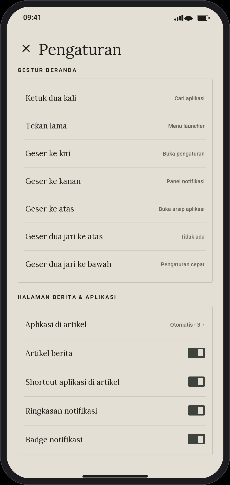
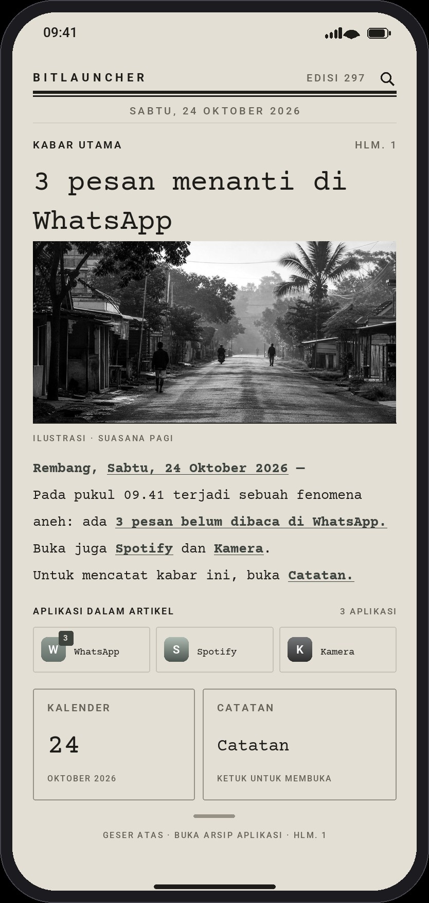
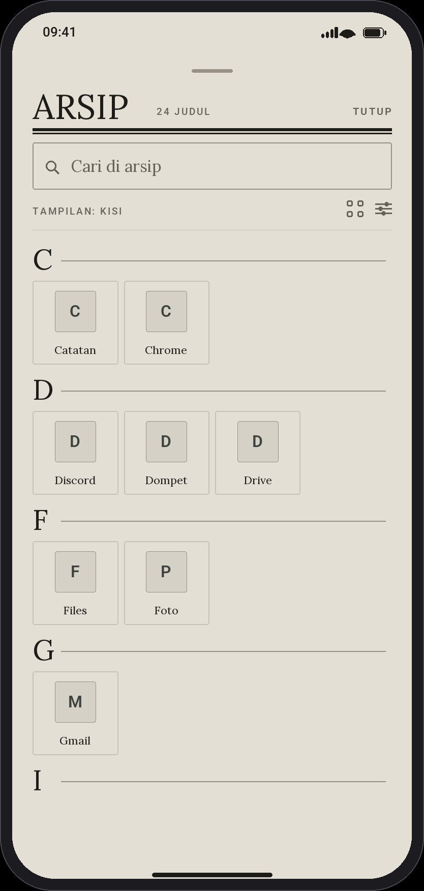

# BitLauncher

Launcher Android dengan dua gaya visual: **folio koran di atas kertas E Ink Kaleido** (default) dan **minimalis ala Niagara + Minima**, dengan kedalaman fitur ala **Nova Launcher**.

Dibangun dengan Kotlin + Jetpack Compose, tanpa iklan, tanpa analytics, dan tanpa izin yang tidak perlu.

[](https://github.com/retrobit-dev/BitLauncher/actions/workflows/android.yml)

---

## Pratinjau tampilan

Karena launcher ini belum dipasang di perangkat, tampilannya bisa dilihat lewat **prototipe UI interaktif** di folder [`preview/`](preview/index.html). Prototipe ini memakai token warna, ukuran tipografi, jarak, dan gestur yang sama dengan kode Compose, sehingga hasilnya mendekati APK.

```bash
python3 -m http.server 8080 --directory preview
# buka http://localhost:8080
```

### Tangkapan layar

### Folio koran · E Ink Kaleido (default)

| Halaman depan | Pengaturan gestur & artikel |
|---|---|
|  |  |

| Arsip aplikasi | Kisi arsip |
|---|---|
|  |  |

| Kaleido malam | Font Typewriter |
|---|---|
|  |  |

| Paket ikon tema |
|---|
|  |

### Minimalis (gaya alternatif)

| Beranda | Laci aplikasi |
|---|---|
|  |  |

| Pengaturan | Aksi aplikasi (tekan lama) |
|---|---|
|  |  |

Gambar dirender oleh [`tools/render_previews.py`](tools/render_previews.py) dan [`tools/render_folio_previews.py`](tools/render_folio_previews.py), memakai palet, ukuran, dan jarak yang sama dengan Compose. Untuk membuat ulang:

```bash
pip install pillow
python3 tools/render_previews.py
python3 tools/render_folio_previews.py
```

File fisik font dan lisensi OFL disimpan satu kali di `app/src/main/res/`; `preview/assets/fonts/` hanya berisi symlink ke sumber tersebut, sehingga tidak ada aset ganda.

Yang bisa dicoba di prototipe:

- Ganti gaya **Folio koran / Minimalis** dan tema **Kaleido / Kaleido malam / Terang / Gelap / AMOLED** secara langsung.
- Simulasikan **3 pesan baru**, tandai semua dibaca, atau matikan akses notifikasi untuk melihat perubahan artikel.
- Buka **Pengaturan → Aplikasi di artikel**, lalu pilih aplikasi sendiri. Notifikasi aplikasi di luar daftar tidak masuk ke headline, prosa, maupun badge chip; daftar kosong dan mode **Otomatis** juga dapat dicoba.
- Ketuk frasa bergaris bawah seperti **“3 pesan belum dibaca di WhatsApp”** untuk membuka aplikasi.
- Ganti kota dateline, tampilkan/sembunyikan foto dan widget, serta pilih aplikasi catatan dari pengaturan prototipe.
- Pilih **Ikon sistem / Ikon tema / Pack pihak ketiga (simulasi)** dan lihat perubahan pada seluruh ikon aplikasi.
- Pilih enam gaya font; ganti foto artikel dengan gambar lokal (maksimum 10 MB di preview), lihat caption kustom, atau pulihkan gambar bawaan.
- Ketuk tanggal untuk membuka kalender atau tautan/kartu **Catatan** untuk membuka aplikasi catatan.
- Ketuk ikon cari di masthead untuk membuka kolom pencarian di samping label **BITLAUNCHER**.
- Buka **Pengaturan → Gestur beranda** untuk memetakan ketuk dua kali, tekan lama, geser kiri/kanan/atas, dan geser dua jari.
- Pilih aksi **Kunci layar**, **Pengaturan cepat**, **Aplikasi terbaru**, atau **Ambil screenshot**; pilih **Tidak ada** untuk mematikan gestur.
- Atur artikel, tautan shortcut aplikasi, ringkasan notifikasi, dan badge ikon secara terpisah.
- Beralih **Daftar / Kisi** dan jumlah kolom 3–6.
- **Tekan lama** aplikasi untuk membuka lembar aksi (shortcut, pin, sembunyikan, info, uninstall).
- **Ketuk** aplikasi untuk melihat umpan balik peluncuran.
- **Geser ke atas** pada indikator bawah untuk membuka laci; **geser kiri** untuk pengaturan dan **geser kanan** untuk panel notifikasi (setelah izin Aksesibilitas).
- **Ketuk dua kali** beranda folio untuk membuka pencarian masthead.
- **Tekan lama** area kosong beranda untuk menu ala Nova.
- Pencarian berperingkat, rel alfabet, dan manajer aplikasi tersembunyi (3 aplikasi contoh sudah disembunyikan).

> Prototipe ini HTML murni tanpa dependensi, bukan emulator Android. Perilaku Android asli (ikon aplikasi sungguhan, shortcut dinamis, profil kerja) hanya bisa dilihat dari APK di artifact CI.

---

## Konsep desain

| Gaya | Inspirasi | Wujud di BitLauncher |
|---|---|---|
| **Folio koran** | Surat kabar + e-paper | Masthead dengan pencarian inline, headline, foto monokrom, artikel berisi shortcut aplikasi/notifikasi, serta kartu Kalender dan Catatan |
| **Kaleido** | E Ink Kaleido | Kertas koran abu-abu hangat, tinta lembut, aksen abu-abu sepi, dan ikon dengan chroma tersisa 8%; varian malam memakai tinta kertas terang |
| **Minimalis** | Niagara + Minima | Jam besar di atas wallpaper, satu kolom favorit, ruang kosong, bar pencarian membulat |
| **Kedalaman** | Nova | Tekan lama untuk aksi, shortcut, sembunyikan aplikasi, grid, backup/restore, tema |

Prinsipnya: **satu tangan, nol kebisingan.** Folio tampil seperti halaman depan koran; fitur yang jarang dipakai tetap berada satu lapis di belakang gestur.

---

## Fitur yang sudah berjalan (0.3.0-alpha)

### Beranda
- [x] **Gaya folio koran** dengan masthead, headline, foto monokrom, dan artikel yang dapat digulir
- [x] Frasa di dalam artikel menjadi **shortcut aplikasi** yang dapat diketuk
- [x] Jumlah pesan/notifikasi dirangkai menjadi berita melalui `NotificationListenerService`
- [x] Pengguna memilih sendiri aplikasi dalam artikel; headline, prosa, chip shortcut, dan badge artikel hanya memakai aplikasi tersebut
- [x] Mode **Otomatis**, pilihan kustom (termasuk aplikasi tersembunyi), dan daftar kosong eksplisit; seluruh pilihan tampil pada shelf, prosa dibatasi tiga nama
- [x] Kota dateline dapat diubah; foto berita dapat diganti dengan gambar lokal atau dimatikan; widget editorial dapat dimatikan
- [x] Ikon cari membuka kolom di samping masthead; tidak ada indeks aplikasi permanen di halaman depan
- [x] Artikel, shortcut aplikasi dalam artikel, ringkasan notifikasi, foto, dan widget dapat diatur terpisah
- [x] Tujuh gestur dapat dipetakan ulang atau dimatikan, termasuk geser dua jari
- [x] Aksi kunci layar, panel notifikasi, pengaturan cepat, recents, dan screenshot via gestur
- [x] Badge jumlah notifikasi pada ikon favorit, hasil pencarian, dan laci (dapat dimatikan)
- [x] Paket **Ikon tema** dengan glyph adaptif/monochrome, tinta tema, bentuk Folio 2dp atau Minimal melingkar
- [x] Icon pack pihak ketiga melalui `appfilter.xml`, dengan fallback ikon asli untuk aplikasi yang tidak dipetakan
- [x] Tanggal membuka kalender; tautan/kartu Catatan membuka aplikasi yang terdeteksi atau dipilih pengguna
- [x] Kartu editorial Kalender dan Catatan (bukan `AppWidgetHost` pihak ketiga)
- [x] Palet **Kaleido** dan **Kaleido malam** seperti koran e-paper, dengan ikon aplikasi yang didesaturasi
- [x] Menjadi launcher default (`CATEGORY_HOME` + `RoleManager`)
- [x] Jam besar + tanggal, sadar format 12/24 jam (mengikuti sistem secara default)
- [x] Ketuk jam → aplikasi alarm, seperti Pixel
- [x] Favorit menjadi tautan cadangan di artikel folio atau kolom vertikal pada gaya minimalis
- [x] Aksi setiap gestur dapat dipilih di pengaturan pada gaya Folio maupun Minimal
- [x] Tekan lama area kosong → menu ala Nova (pengaturan, wallpaper, launcher default, refresh)
- [x] Wallpaper terlihat di belakang beranda (window transparan + `windowShowWallpaper`)
- [x] Banner halus "jadikan launcher default" bila belum aktif

### Laci aplikasi & pencarian
- [x] Daftar seluruh aplikasi via `LauncherApps` (bukan `PackageManager` langsung)
- [x] Dukungan **multi-profil / work profile** dengan badge "kerja"
- [x] Pencarian berperingkat: awalan → substring → inisial → subsequence
- [x] Tampilan daftar dan kisi (3–6 kolom, bisa diubah dari laci maupun pengaturan)
- [x] Rel alfabet untuk lompat cepat, dengan getaran halus
- [x] Seksi per huruf
- [x] Pembaruan otomatis saat aplikasi dipasang/dicopot (`LauncherApps.Callback`)

### Aksi per aplikasi
- [x] Buka aplikasi
- [x] Shortcut dinamis/manifest/pinned di bottom sheet
- [x] Pin / lepas pin dari beranda
- [x] Sembunyikan aplikasi (beranda + laci)
- [x] Info aplikasi
- [x] Copot pemasangan lewat dialog sistem (fallback ke info untuk aplikasi profil kerja)

### Pengaturan
- [x] Gaya Folio / Minimalis dan tema Kaleido / Kaleido malam / Sistem / Terang / Gelap / AMOLED
- [x] Pemilih Ikon sistem / Ikon tema / icon pack pihak ketiga yang terpasang
- [x] Enam pilihan gaya font: bawaan, Lora, Roboto, Typewriter, Pixel, dan Operator-style
- [x] Pemilih gambar artikel via Storage Access Framework, tanpa izin storage luas
- [x] Pemilih multi-select aplikasi artikel dengan pencarian, mode Otomatis, dan empty state yang dapat diatur
- [x] Warna dinamis Material You (Android 12+)
- [x] Toggle jam, tanggal, format 24 jam, baris ringkas
- [x] Tata letak laci, jumlah kolom, rel alfabet, autofocus pencarian, getaran
- [x] Manajer aplikasi tersembunyi dengan pencarian
- [x] Pintasan launcher default dan pemilih wallpaper sistem
- [x] Pengaturan akses notifikasi dengan penjelasan privasi; isi pesan tidak dibaca/disimpan
- [x] Aksi global Accessibility untuk gestur sistem; tanpa event atau konten layar
- [x] Ekspor/impor pengaturan ke JSON lewat Storage Access Framework

### Teknis
- [x] Material 3 + edge-to-edge
- [x] Cache ikon `LruCache` (256 entri) agar scroll tetap 60 fps
- [x] Clock hanya bangun sekali per menit, bukan per detik
- [x] State terpusat di `ViewModel` + `StateFlow`, preferensi ringan via `SharedPreferences`
- [x] Parser icon pack untuk resource XML/raw/assets, pemetaan komponen, dan kalender harian
- [x] CI GitHub Actions yang membangun APK debug serta APK release test-signed, checksum, dan verifikasi tanda tangan

---

## Struktur proyek

```
app/src/main/java/dev/retrobit/bitlauncher/
├── MainActivity.kt              # entry point, edge-to-edge, wallpaper terlihat
├── LauncherViewModel.kt         # gabungan repo + pengaturan
├── data/
│   ├── LaunchableApp.kt         # model aplikasi (identitas stabil untuk favorit)
│   ├── LauncherRepository.kt    # LauncherApps, profil, callback, shortcut
│   ├── IconPackRepository.kt    # Penemuan pack, appfilter, resource dan cache ikon
│   └── SettingsRepository.kt    # preferensi + backup JSON
├── ui/
│   ├── LauncherApp.kt           # navigasi Beranda / Laci / Pengaturan
│   ├── notifications/…          # listener + alur jumlah notifikasi (tanpa isi pesan)
│   ├── home/{HomeScreen,FolioHomeScreen}.kt
│   ├── drawer/{AppDrawerScreen,FolioDrawerScreen}.kt
│   ├── settings/…
│   ├── components/…             # ikon, jam, rel alfabet, bottom sheet
│   └── theme/Theme.kt
└── util/
    ├── AppSearch.kt             # pencarian berperingkat
    ├── DrawerItems.kt           # pengelompokan per huruf
    └── SystemIntents.kt         # intent sistem & cek launcher default
```

---

## Aplikasi dan notifikasi artikel

Buka **Pengaturan → Halaman koran → Aplikasi di artikel**. Pemilih menyediakan pencarian dan multi-select untuk semua aplikasi yang terinstal, termasuk aplikasi yang disembunyikan dari laci.

| Mode | Perilaku |
|---|---|
| **Otomatis** | Kompatibilitas perilaku lama: favorit terlebih dahulu, atau tiga aplikasi pertama bila belum ada favorit |
| **Pilihan kustom** | Hanya aplikasi terpilih yang menjadi chip shortcut dan sumber headline, prosa, serta badge notifikasi artikel |
| **Daftar kosong** | Tidak ada aplikasi atau notifikasi artikel; tidak ada fallback diam-diam, dan tersedia tombol menuju pengaturan |

Shelf menampilkan seluruh aplikasi pilihan dalam baris tiga kolom, sedangkan paragraf editorial dibatasi maksimal tiga nama agar tetap terbaca. Filter ini khusus halaman artikel: badge global pada favorit minimal, pencarian, dan laci tetap mengikuti pengaturan badge seperti sebelumnya. Jika izin notifikasi dicabut, jumlah lama tidak dipakai untuk headline maupun ringkasan.

Pilihan disimpan sebagai `newsApps` di preferensi dan backup JSON: `null` berarti Otomatis, array berisi kunci aplikasi berarti kustom, dan array kosong berarti tidak ada aplikasi artikel.

---

## Font dan foto artikel

Buka **Pengaturan → Tampilan → Jenis font**. Pilihan diterapkan ke headline, isi artikel, label, tombol, dan layar lain pada kedua gaya launcher.

| Pilihan | Keluarga font | Karakter |
|---|---|---|
| Bawaan gaya | Serif untuk folio / sans untuk minimalis | Perilaku awal launcher |
| Lora | Lora | Serif editorial |
| Roboto | Roboto | Sans yang netral |
| Typewriter | Courier Prime | Mesin tik |
| Pixel | Silkscreen | Bitmap/pixel |
| Operator-style | Space Mono | Monospace teknis; alternatif open-source, bukan Operator Mono komersial |

Untuk mengganti foto, buka **Pengaturan → Halaman koran → Gambar artikel → Pilih gambar**. Android membuka pemilih dokumen; tidak ada izin akses storage luas. Caption otomatis menandai foto pilihan pengguna, dan **Gambar bawaan** memulihkan foto awal.

Gambar dibaca di thread IO, di-downsample hingga sisi terpanjang 1600 px, lalu diberi filter e-paper pada tema Kaleido. Jika file dipindahkan, dihapus, atau izin URI dicabut, launcher kembali ke gambar bawaan. Preferensi font dan URI gambar ikut dalam backup JSON; URI dari perangkat lain bisa tidak valid dan akan memakai fallback tersebut.

Font dikemas offline bersama lisensinya: `OFL-Lora.txt`, `OFL-Roboto.txt`, `OFL-CourierPrime.txt`, `OFL-Silkscreen.txt`, dan `OFL-SpaceMono.txt` di `app/src/main/res/raw/`.

---

## Paket ikon

Buka **Pengaturan → Tampilan → Paket ikon**.

| Pilihan | Perilaku |
|---|---|
| **Ikon sistem** | Ikon asli aplikasi; filter e-paper tetap diterapkan pada tema Kaleido |
| **Ikon tema** | Foreground adaptive icon atau glyph monochrome Android 13+ diwarnai dengan warna primer tema, di atas permukaan dan bentuk yang mengikuti gaya launcher |
| **Pack pihak ketiga** | Resource ikon dari pack yang terpasang; desain dan warna pack dipertahankan |

Ikon diterapkan pada favorit, pencarian, arsip daftar/kisi, lembar aksi, pengelola aplikasi tersembunyi, dan shortcut yang memiliki pemetaan. Ikon aplikasi lama yang tidak menyediakan adaptive foreground tetap memakai ikon asli.

Pack kompatibel menggunakan intent ikon Nova/ADW/Apex/GO/Lawnchair dan `appfilter.xml` di `res/xml`, `res/raw`, atau `assets`. Pemetaan komponen serta kalender harian didukung. Aplikasi tanpa pemetaan memakai ikon asli; pembentukan otomatis dengan `iconback`, `iconupon`, dan `iconmask` belum diterapkan.

Pilihan ikut dalam backup JSON. Jika pack dicopot atau tidak tersedia setelah restore, pilihan kembali ke **Ikon tema**. Deteksi memakai deklarasi `<queries>` khusus intent icon pack, tanpa izin `QUERY_ALL_PACKAGES`.

---

## Build

Kebutuhan: JDK 17, Android SDK 35.

```bash
./gradlew :app:assembleDebug
# APK debug: app/build/outputs/apk/debug/app-debug.apk

./gradlew :app:assembleRelease
# APK release siap sideload: app/build/outputs/apk/release/app-release.apk
```

Build release bersifat **non-debuggable** dan ditandatangani dengan test key `app/test-release.p12` agar dapat langsung dipasang tanpa Android Studio. Ini adalah rilis sideload untuk pengujian, **bukan** rilis produksi/Play Store; jangan gunakan test key publik sebagai identitas penerbit produksi.

Verifikasi dan pasang:

```bash
apksigner verify --print-certs app/build/outputs/apk/release/app-release.apk
sha256sum app/build/outputs/apk/release/app-release.apk
adb install -r app/build/outputs/apk/release/app-release.apk
adb shell cmd package set-home-activity dev.retrobit.bitlauncher/.MainActivity
```

Jika versi debug atau APK dengan kunci berbeda sudah terpasang, hapus versi lama terlebih dahulu (pengaturan lokal ikut terhapus), lalu jalankan `adb install` tanpa `-r`. Untuk pemasangan tanpa ADB, unduh **`app-release.apk`** dari [prerelease v0.3.0-alpha](https://github.com/retrobit-dev/BitLauncher/releases/tag/v0.3.0-alpha) atau artifact **`bitlauncher-release`** dari workflow [Android CI](https://github.com/retrobit-dev/BitLauncher/actions/workflows/android.yml). Jika memakai artifact, ekstrak ZIP terlebih dahulu. Buka APK dan izinkan **Install unknown apps** bila diminta Android. Cocokkan berkas dengan SHA-256 yang disertakan.

---

## Batasan yang diketahui

Ini fondasi yang serius, bukan launcher yang sudah selesai. Yang **belum** ada (dan alasannya):

| Belum ada | Catatan |
|---|---|
| Widget pihak ketiga (`AppWidgetHost`) | Kartu Kalender/Catatan internal sudah ada; host widget umum butuh konfigurasi + persistensi |
| Generator ikon pack untuk aplikasi tanpa pemetaan | `appfilter.xml` eksplisit dan kalender didukung; `iconback`/`iconupon`/`iconmask` masih dalam roadmap |
| Rel alfabet melompat ke seksi lengket | Saat ini header ikut ter-scroll |
| Foto artikel dari backup | URI dokumen bersifat perangkat/aplikasi-spesifik; bila tidak lagi dapat diakses, foto bawaan digunakan |
| Tanda tangan release | Test key untuk sideload; bukan kunci produksi dan bukan distribusi Play Store |
| Jumlah pesan | Estimasi dari notifikasi aktif, bukan isi database pesan; perlu izin khusus **Akses Notifikasi** |
| Aksi gestur sistem | Memerlukan opt-in **Aksesibilitas**; hanya aksi global yang dipilih, tanpa membaca konten layar |
| Kunci layar / screenshot | Aksi Accessibility; kunci layar Android 9+, screenshot Android 11+ |
| Recents kustom | Tidak mungkin sejak Android 5 (API dihapus) |

Detail rencana ada di [docs/ROADMAP.md](docs/ROADMAP.md), sedangkan wireframe dan token desain ada di [docs/DESIGN.md](docs/DESIGN.md).

---

## Lisensi

Belum ditentukan. Sebelum rilis publik, tambahkan lisensi (MIT/Apache-2.0 disarankan) dan file `LICENSE`.
